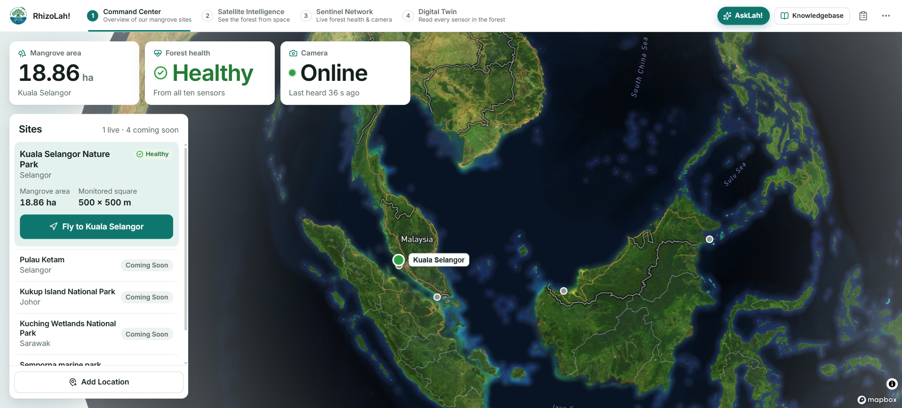
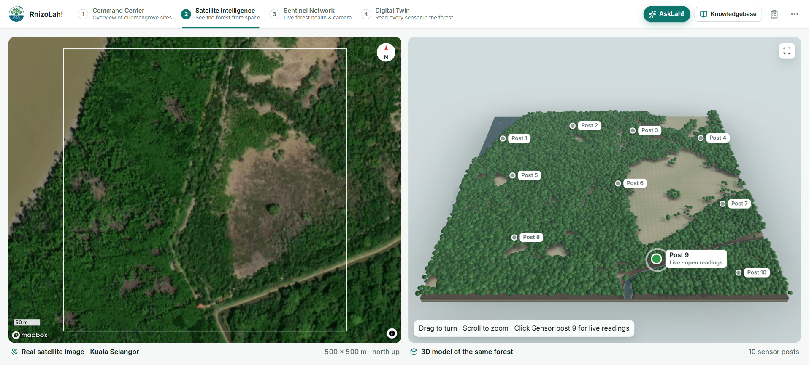
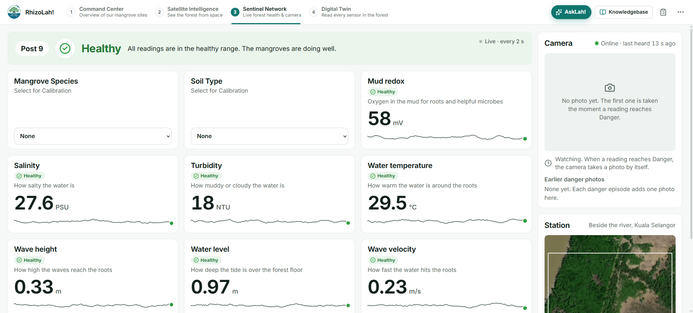
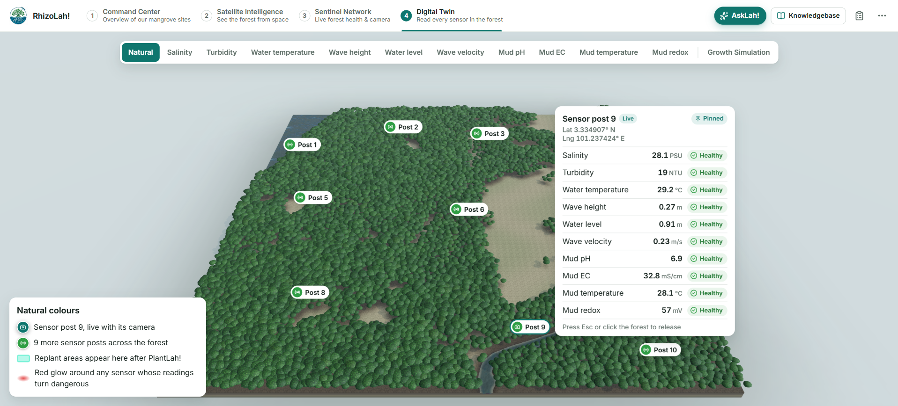

# RhizoLah! | Blue Carbon Sentinel

A browser-based demonstration of mangrove monitoring at Kuala Selangor Nature Park, Malaysia. Explore the site on a satellite map, compare it with a 3D forest, follow environmental readings, and try danger detection and replanting scenarios. With **Add Location** you can pick any 500 × 500 m square on Earth and the app generates a matching 3D forest for it from the live satellite image.

This repository contains a frontend demo built with React, TypeScript and Vite. Sensor readings, camera activity, replanting scans and the text labelled "AI Suggestion" are simulated or generated locally. Satellite imagery comes from Mapbox. The one real AI feature is the **AskLah!** chat, which uses the SEA-LION API and needs a SEA-LION API key (optional; everything else works without it). You do not need a backend, database or connected ESP32 board to run it.

- [Product overview](#product-overview)
- [Set up the project](#set-up-the-project)
- [Start it again on Windows](#start-it-again-on-windows)
- [Try the demo](#try-the-demo)
- [Add your own location](#add-your-own-location)
- [Turn on a "Coming Soon" site](#turn-on-a-coming-soon-site)
- [How the 3D forest is generated](#how-the-3d-forest-is-generated)
- [Use your own camera photos](#use-your-own-camera-photos)
- [Development and build commands](#development-and-build-commands)
- [Project structure](#project-structure)
- [Troubleshooting](#troubleshooting)

## Product overview

The four pages follow the same forest through different views. The monitored square is 500 × 500 m (25 hectares). Kuala Selangor has ten sensor posts, numbered 1 to 10. Only Sensor post 9 is live: it streams the readings and carries the camera. A location you add gets up to ten, placed by code. Each reading contains ten environmental measurements. The interface uses the RhizoLah! name.

### 1. Command Center

See the Malaysian site catalogue, mangrove area, forest health and camera status. Kuala Selangor is the active demo site; four other sites are marked "Coming Soon". Select **Fly to Kuala Selangor** to move into the site and open Satellite Intelligence. **Add Location**, at the bottom of the Sites panel, adds a site of your own; each added site gets the same card, a pin on the globe and its own **Fly to** button. The three tiles at the top describe the site you flew to last.



### 2. Satellite Intelligence

Compare Mapbox satellite imagery on the left (captioned with the site name, or its latitude and longitude when it has none) with a 3D model of the same forest on the right. For Kuala Selangor the model uses stored, hand-traced canopy and water outlines. For any other site it is generated from the satellite image each time the site is opened. Drag to rotate the model, scroll to zoom, and select Sensor post 9 (the live post) to open its readings in Sentinel Network. Every post is labelled on the model ("Post 1" to "Post 10"), including the ones that are not live.



### 3. Sentinel Network

Follow ten measurements updated every two seconds: salinity, turbidity, water temperature, wave height, water level, wave velocity, mud pH, mud EC, mud temperature and mud redox. Mud redox is the microbe check: it shows how much oxygen the mud holds, and so which microbes it can support. Below -100 mV, sulfide-making microbes take over from the helpful ones. Each card shows a value, trend and health status. The first row also has two lists, **Mangrove Species** and **Soil Type** (both start at None; each card reads "Select for Calibration"). Choosing one colours the trees or the ground in the Digital Twin's Natural colours and Growth Simulation views; the colours are illustrative and change nothing else. The camera panel displays a photo after a simulated danger event, and the station map shows its location.



### 4. Digital Twin

Explore the 3D forest in natural colours or select a measurement layer. Hover over a sensor post to see its coordinates and all nine readings; click the post to pin the card. Replant Areas are filled and outlined in mint and labelled "Suitable to Plant", "Planted, growing" or "Grown"; point at the label for the AI Suggestion card, click it to pin. The card leads with a photo of the suggested species and four answers: Mangrove Species, Soil Type, Number of Seedlings for the empty area, and the Distance between seedlings (a square grid; Rhizophora spacings are Matang's, the other species use demo guide values). The reasons, sources and Readings fold away under **Why this suggestion** and scroll. Pin the card and point at **Cost** (bottom right) for everything it would take to finish planting the area: seedlings, stakes, labour, transport, any soil or mud the advice asks for, replacing first-year losses, site preparation and monitoring. The prices are demo estimates in ringgit, set in `src/sim/planting.ts`. The last layer, **Growth Simulation**, previews seeds growing into trees in the Replant Areas over 15 years (Play runs it in about 10 seconds). Its panel also shows the **Estimated CO₂ reduced** by the planted trees at the chosen year: above-ground only, from Matang's measured biomass (K4) scaled by the K3 growth curves and the plants still standing. Monitoring stays at Year 1 in this demo.



## Set up the project

Complete these steps once. All terminal commands below run from the project folder, which contains `package.json`, unless a step says otherwise.

### Step 1: Install the prerequisites

You need:

| Requirement | What to install or prepare |
| --- | --- |
| Node.js and npm | Install a current LTS release from [Node.js](https://nodejs.org/en/download). npm comes with Node.js. The locked Vite dependencies require Node.js 20.19 or newer within the 20.x series, or Node.js 22.12 or newer. |
| Browser | A current desktop browser with WebGL support. Chrome or Edge with graphics acceleration enabled is a suitable starting point. |
| Internet connection | Required to install dependencies and load Mapbox maps and satellite imagery. |
| Mapbox account and public token | Required for the maps. Step 3 explains how to configure it. |
| Git, if cloning | Install [Git](https://git-scm.com/downloads), or use the ZIP download in Step 2. |

After installing Node.js, open a **new** terminal. On Windows, use PowerShell, Command Prompt or the terminal in VS Code. Check both commands:

```sh
node --version
npm --version
```

Both commands should print a version number. If either command is unrecognised, restart the terminal and check that Node.js was added to your system's PATH during installation.

### Step 2: Download the project and open its folder

If you use Git, run these commands from the directory where you keep projects:

```sh
git clone https://github.com/ShawnLYZ/Blue-Carbon-Sentinel.git
cd Blue-Carbon-Sentinel
```

Alternatively, open the [GitHub repository](https://github.com/ShawnLYZ/Blue-Carbon-Sentinel), select **Code → Download ZIP**, and extract the ZIP. Open a terminal in the extracted folder containing `package.json`. The folder may be named `Blue-Carbon-Sentinel-main`.

On Windows, you can open that folder in File Explorer, click the address bar, type `powershell`, and press Enter. You can also change directory manually, replacing this example with your actual folder:

```powershell
cd "C:\path\to\Blue-Carbon-Sentinel"
```

### Step 3: Configure the Mapbox token

1. Sign in to [Mapbox](https://console.mapbox.com/) or create an account.
2. Open the [Access tokens page](https://console.mapbox.com/account/access-tokens/). Copy your default public token for local development, or create a public token for this project. Public tokens begin with `pk.`. See [Mapbox's token guide](https://docs.mapbox.com/help/dive-deeper/access-tokens/) for the account steps.
3. In the project folder, make a copy of `.env.example` named `.env.local`. If `.env.local` already exists, edit it instead of overwriting it.

   Windows PowerShell:

   ```powershell
   Copy-Item .env.example .env.local
   notepad .env.local
   ```

   macOS or Linux:

   ```sh
   cp .env.example .env.local
   ```

   Then open `.env.local` in a text editor.

4. Replace the empty value with your public token and save the file:

   ```dotenv
   VITE_MAPBOX_TOKEN=pk.paste_your_public_token_here
   ```

   Replace the whole example value with the token you copied. Keep the variable name exactly as shown. The file must be named `.env.local`, not `.env.local.txt`, and sit beside `package.json`.

5. If your token has URL restrictions, allow the local address you will use, normally `http://localhost:5173`. Include any other address or port you use for this project. Mapbox explains [URL restrictions](https://docs.mapbox.com/accounts/guides/tokens/#url-restrictions) in its account documentation.

Use a public token for this browser application. Vite includes `VITE_` values in the client bundle, so do not put a secret Mapbox token or other credentials there. `.env.local` is ignored by Git.

The sensors and 3D demo can run without a token, but the map panels will show "Satellite image unavailable". After changing `.env.local`, stop and restart the development server. Rebuild if you are using a production build.

#### Optional: the SEA-LION key for AskLah!

The **AskLah!** chat calls [SEA-LION](https://sea-lion.ai/), AI Singapore's Southeast Asian language model. Get an API key from the [SEA-LION playground](https://playground.sea-lion.ai/) and add it to the same `.env.local` file:

```env
SEALION_API_KEY=sk-paste_your_key_here
```

This name has no `VITE_` prefix on purpose: the key stays in the local Vite server, which relays the chat at `/api/chat`, and is never built into the page. The chat therefore works under `npm run dev` and `npm run preview`, not from `dist` served by another web server. It uses `aisingapore/Gemma-SEA-LION-v4-27B-IT`; to try another SEA-LION chat model, add `SEALION_MODEL=` with its id. Restart the development server after changing either value.

### Step 4: Install dependencies

Run:

```sh
npm ci
```

This installs the dependency versions recorded in `package-lock.json` into `node_modules`. Wait until the command finishes successfully and the terminal prompt returns. You only need to install again when dependencies change or `node_modules` is removed.

If PowerShell reports that `npm.ps1` cannot be loaded, use `npm.cmd ci` instead. The same substitution works for the other npm commands in this guide.

### Step 5: Start the development server

Run:

```sh
npm run dev
```

Vite starts at [http://localhost:5173](http://localhost:5173) and opens your browser automatically. If no tab opens, open that address yourself. The initial page is Command Center, normally at [http://localhost:5173/#/command](http://localhost:5173/#/command).

Keep the terminal running while you use the demo. Do not open `index.html` directly from File Explorer; the project needs Vite to process its source files and camera photo list.

To stop the server, focus its terminal and press **Ctrl+C**. If Command Prompt asks whether to terminate the batch job, enter `Y`.

### Step 6: Confirm the setup works

1. Check that Command Center opens with the site list and the Kuala Selangor marker on a satellite map. A missing map usually points to the token or internet connection.
2. Open Satellite Intelligence and wait for the 3D forest to load. Drag the model and scroll to check rotation and zoom.
3. Open Sentinel Network and watch the readings update every two seconds. An empty camera panel is normal before the first danger event.
4. Open Digital Twin and hover over a sensor post. Its reading card should appear.

If you have used this browser for the demo before, it may restore an earlier danger event, Replant Areas or tasks. Use **⋯ → Reset demo → Reset** to return to healthy readings with no Replant Areas or tasks.

## Start it again on Windows

After Node.js is installed, the project is extracted and `.env.local` is configured, you can launch the demo by double-clicking **`start.cmd`** in File Explorer.

The launcher switches to the correct folder, checks for Node.js, runs `npm install` if `node_modules` does not exist, checks that port 5173 is free, and starts the development server. Keep its window open; close it to stop the demo.

If `node_modules` already exists, the launcher skips installation. After pulling dependency changes, run `npm ci` manually before launching again.

On macOS or Linux, use `npm run dev` from the project folder.

## Try the demo

Use the navigation tabs or press **1**, **2**, **3** or **4** to move between pages. The demo controls are in the **⋯** menu at the top right, beside the Tasks icon. The **Knowledgebase** button, left of the camera status, lists the reference documents behind the suggestions and lets you upload your own (kept in this browser only).

### Explore the site

1. In Command Center, select **Fly to Kuala Selangor**.
2. In Satellite Intelligence, compare the satellite view with the 3D canopy. Drag to turn, scroll to zoom, or double-click the forest to move closer.
3. Select the **Sensor post 9** marker in the 3D view to open Sentinel Network.
4. In Digital Twin, choose a measurement layer, hover over a sensor post, and click it to pin its reading card. Press **Esc** or click the forest to release the card.

### Simulate danger and a camera response

1. Open Sentinel Network so you can watch the sensor cards and camera panel.
2. Open **⋯ → Simulate danger**.
3. Watch the readings move from Healthy through Warning to Danger over about ten seconds. The scenario is **Factory Pollution**: oily, acidic, hot waste water from upstream reaches the station. Turbidity, water temperature, mud pH, mud EC and mud redox reach Danger, mud temperature reaches Warning, and salinity, waves and water level stay Healthy. The AI Summary explains each reading as pollution and advises reporting the discharge.
4. When a reading enters Danger, the demo requests a camera photo automatically. A photo normally arrives about 6 to 12 seconds after the request. One danger episode triggers one automatic photo; it shows the oil slick in `camera-photos/factory-pollution.jpg`.
5. Select the photo to open it full size. Photos from your own camera are labelled **ESP32-CAM photo**.
6. Choose **⋯ → Restore healthy** after the danger transition finishes. The readings return to Healthy over about ten seconds, and the photo history remains available.

The camera panel also has a **SaveLah!** action when its generated warning or danger summary appears. That action clears the displayed photo history, restores healthy readings and adds a Prevention Task under the Tasks icon (step buttons **Check Site!** then **Done Fixing!**, with a timeline). Use **Restore healthy** when you want to keep the photos.

### Run a replanting scan

1. Wait until all readings are Healthy and the recovery transition has finished.
2. Select **⋯ → Scan for replanting**. The app opens Sentinel Network and the scan overlay.
3. Wait about four seconds for the scan and another two seconds for its sample photo. The title shows the Sensor post nearest the patch (Post 6 for the large central patch at Kuala Selangor). Review the selected empty patch, local readings, approximate seedling count and the **Mud check**: hours flooded each day, mud level change, soil type, organic matter and a lab DNA test for helpful microbes. The AI Suggestion covers the **Mangrove Species** (what to plant, why it fits the salinity and distance from water, and the second choice) and the **Soil Type** (the soil that species grows best in, the soil found here, and what the mud check found and what to do about it).
4. Select **PlantLah!** once it is enabled. Only then is the area saved: it turns mint on the station map and a Restoration Task appears under the Tasks icon (step buttons **Plant!** then **Done Growing!**, with a timeline). Closing the scan without it saves nothing.
5. Open Digital Twin to see the area in mint, labelled "Suitable to Plant". Point at the label for the Species Suggestion, which repeats the mud check's findings. In the Growth Simulation, an area whose mud check found something to fix loses plants faster.

Kuala Selangor has three predefined patches; an added site has up to three, found from its image, and may have none. After a site's patches have all been used, a scan reports that no suitable empty area was found. Use **Reset demo** to make the patches available again. The year stays at 1; trees appear only in the Growth Simulation preview.

### AskLah! about the forest

Select **AskLah!** in the top bar (left of the Knowledgebase). A chat window opens at the top right; the page under it keeps working, and **Esc** or the **×** closes it. Pick a suggested question or type your own, in English or Malay.

Each question is sent with the Knowledgebase (the seven built-in sources, as short facts with page numbers where known) and a snapshot of what is on screen at that moment: the Current Site, all ten readings and their Bands, any danger episode, the camera, Replant Areas with their Species Suggestion and mud check, and open tasks. The model is told to answer only from those. Every sentence ends with a source box, the same as "Suitable to Plant" in the Digital Twin: a numbered book box opens that source in the Knowledgebase, and a green **Live** box marks a fact from the simulated readings (it opens the Sentinel Network). If the Knowledgebase does not cover a question, the answer says so. If an answer cites no Knowledgebase source, a warning shows under it.

The chat is AI and can still be wrong; check the linked sources. It needs the internet and the SEA-LION key. Your uploads are not read by the chat. The conversation is kept only until the page is reloaded; **New chat** clears it.

### Reset between demonstrations

Select **⋯ → Reset demo**, then confirm with **Reset**. This restores Healthy readings, resets the year to 1, clears Replant Areas and tasks at every site, removes added locations and returns to Kuala Selangor. Camera photos and their history, and Knowledgebase uploads, are kept.

Danger events, photo history, Replant Areas, tasks, added locations and the site you flew to last are stored in this browser's local storage under `bcs-demo-state-v1`. Reloading normally preserves them. A different browser, private window or local address has separate storage. Clearing site data removes the saved demo history.

## Add your own location

Nothing needs to be typed or measured: no heights, no depths, no outlines.

1. In Command Center, select **Add Location** at the bottom of the Sites panel. The tiles and the Sites panel slide away and place names appear on the globe.
2. Drag to turn the globe and scroll to zoom. Click a place: the globe flies down and flattens into the satellite map.
3. A fixed **500 × 500 m** square sits in the middle of the screen. Drag the map under it until the square covers the forest you want. Zoom out and click somewhere else if you picked the wrong place.
4. The bar at the bottom shows a name, already filled in from the coordinates. Type over it if you want something friendlier (up to 40 characters).
5. Select **Use this area**. The app reads the satellite image for a moment, saves the location and opens Satellite Intelligence for it: the real image on the left, the generated 3D forest on the right, with its sensor posts.

From there everything works as it does for Kuala Selangor: the live post opens Sentinel Network, Digital Twin shows the same forest, and the replanting scan offers that forest's own empty patches. Replanting progress is kept per site. The sensor readings, danger simulation and camera are shared by all sites, because the demo has one simulated station.

Things to know:

- **"No forest found in this square."** The square has under 5% tree cover (open sea, a city, bare land). Move the map and try again; nothing is saved.
- **"Satellite image unavailable".** The image could not be read. Check the connection and the Mapbox token. Adding a location and opening an added site both need the internet.
- **Cancel** or **Esc** leaves the picker and puts the Command Center back as it was.
- **Remove**, on an added site's card, deletes it straight away, with its replanting progress. Kuala Selangor and the "Coming Soon" sites cannot be removed.
- **Reset demo** removes every added location and returns to Kuala Selangor.
- Added locations are remembered in this browser (name, centre and mangrove area only). The satellite image itself is never saved; the forest is generated again each time the site is opened, so it is the same every time unless Mapbox updates its imagery.

## Turn on a "Coming Soon" site

Pulau Ketam, Kukup Island National Park, Kuching Wetlands National Park and Semporna are listed in `src/site/catalogue.ts` with `live: false`. To turn one into a working site, change that one value to `true`:

```ts
{ id: 'pulau-ketam', name: 'Pulau Ketam', shortName: 'Pulau Ketam', region: 'Selangor',
  centre: { lat: 3.0215, lng: 101.2565 }, source: 'generated', live: true, origin: 'catalogue' },
```

Save the file. The site's row becomes a full card with **Fly to Pulau Ketam**, its pin turns into a live pin, and the header count changes (for example "2 live · 3 coming soon"). Its forest, sensor posts and replant patches are generated from the Mapbox image at `centre` the first time you fly there. Nothing else needs to be supplied.

To add a new catalogue site, add one more entry to `CATALOGUE_SITES` with its own `id`, `name`, `shortName` (used in "Fly to ..."), `region` and `centre`, keeping `source: 'generated'` and `origin: 'catalogue'`.

The listed centres are approximate points. Checked against the current imagery: Kukup Island's square is solid forest; Pulau Ketam's sits mostly on the village, with forest only along its northern edge; Kuching Wetlands' and Semporna's sit on open water, so they would open with almost no forest. Before switching one on, move its `centre` onto the forest you want. The easy way to find coordinates is the Add Location picker, which shows the centre of the square as you move the map.

## How the 3D forest is generated

No AI API and no AI model are involved. It is ordinary code that runs in your browser, in the forest Web Worker, each time a generated site is opened.

1. **Read the image** (`src/forest/survey.ts`). The app fetches the Mapbox Satellite tiles under the square (at most nine) and resamples them to one 500 × 500 image at exactly 1 m per pixel, north up. The pixels stay in memory only.
2. **Classify every square metre** (`src/forest/classify.ts`). Using colour and local texture, each pixel becomes canopy, water or bare ground. Leaf-green pixels above a threshold taken from the image itself are canopy. Large areas that are blue or very smooth are water; dark, narrow gaps through the canopy are creeks. Everything else (mud, sand, paths, roads, buildings) is bare ground. Small shadows between crowns are filled in and specks are removed. The result is the same kind of Canopy Map that Kuala Selangor's hand-traced outlines produce.
3. **Build the forest** (`src/forest/model.ts`). The same build that Kuala Selangor uses turns the Canopy Map into terrain, water, trees and breathing roots. Heights and depths are estimated: the ground is gently uneven and slightly raised under forest, water beds dip about 2 m, and trees are 8 to 18 m tall, taller inside a stand than at its edge.
4. **Place the equipment** (`src/forest/layout.ts`). The live post goes on canopy beside the main body of water (or beside the largest clearing when there is no water). Up to nine more posts are spread as far apart as possible, at least 60 m from each other. The live post is numbered Sensor post 9 (or takes the last number when fewer posts fit); the others take the remaining numbers from north to south. The 3D view leaves out the few trees between the live post and the camera's end point when you select it, so the dive always ends on a clear view of the post's hardware. Up to three clearings enclosed by forest (about 300 to 12,000 m²) become the replant patches, largest first.

The worker (`src/forest/forest.worker.ts`) runs these steps, and `src/forest/forestData.ts` hands the result to the pages. On a normal connection a site is ready in about two seconds.

### Limits, and how it can be wrong

The generated forest is an **estimate in the right style that follows the layout of the image**. It is not a survey and must not be presented as one.

- It cannot tell mangrove from other trees. "Mangrove area" on a generated site means tree cover.
- Heights and depths are not measured. There is no elevation or depth data.
- The mud check is simulated. Its soil facts are a fixed function of the position, not a soil sample, and its limits and its effect on plant survival are guide values chosen for the demo, not figures from a Knowledgebase source. Mud redox shows which microbes the mud can support; it cannot name the species living there.
- Cloud, haze, deep shadow and blurred imagery are misread. Hazy forest can come out with false ponds in it.
- Green or brown water with waves or boat wakes can be read as mud or as strips of trees. Smooth mudflats can be read as water.
- Very green, smooth ground such as a field can be read as water or as canopy.
- Checked against Kuala Selangor's hand-traced map, the classifier agrees on 96.9% of the square: it finds the river and the large clearing, but misses the narrow channel in the south-east corner.
- If Mapbox updates its imagery, a site's forest, posts and patches can change, and earlier replanting progress for a patch that has moved is ignored.
- Deriving a forest from Mapbox imagery is done here on the same non-commercial basis as the traced outlines. Check Mapbox's terms before any commercial use.

## Use your own camera photos

The project ships with one photo in `camera-photos`, `factory-pollution.jpg`, which the camera captures in the Factory Pollution scenario. Without it, the simulated danger camera uses the four bundled mangrove photos in `public/sample-photos`. Their credits and licences are recorded in [SOURCES.md](public/sample-photos/SOURCES.md) and shown when a sample photo is opened full size.

To replace the danger camera's sample library:

1. Save your camera images directly into the top-level `camera-photos` folder. Supported extensions are `.jpg`, `.jpeg`, `.png` and `.webp`. Files in subfolders are not included.
2. Name them in the order you want them used, for example `01-river.jpg`, `02-roots.jpg` and `03-canopy.jpg`. The demo sorts filenames and cycles through the images.
3. While the development server is running, adding or removing an image reloads the page automatically. Replacing the contents of an existing file may require a server restart and browser reload.
4. Trigger a new danger event to see a photo from the new library. Existing photo history still refers to the earlier images until it is cleared.

If `camera-photos` contains at least one supported image, those files replace the bundled danger photos and appear with the **ESP32-CAM photo** label. Adding files does not connect a live camera or upload endpoint. Removing all custom images switches new captures back to the bundled samples.

The replanting scan uses its own fixed sample image at `public/scan-photos/empty-area.jpg`; changing `camera-photos` does not replace that image. If neither custom nor bundled danger photos exist, requests fail and the panel offers **Try again**. Add an image before retrying.

For a production build, add your photos **before** running `npm run build`. They are copied into `dist/camera-photos`; changes to the source folder require another build.

## Development and build commands

Run these commands from the project root:

| Command | Purpose |
| --- | --- |
| `npm ci` | Install the versions in the lockfile. |
| `npm run dev` | Start Vite on port 5173, open the browser and reload on source changes. |
| `npm run typecheck` | Check TypeScript types without producing build files. |
| `npm run build` | Create the static production files in `dist`. |
| `npm run preview` | Serve the existing `dist` build locally on port 5173 and open the browser. |

To validate and preview a build:

```sh
npm run typecheck
npm run build
npm run preview
```

Stop the development server first because preview uses the same port. Preview does not rebuild the app; rerun `npm run build` after source, photo or environment changes. The Mapbox token is embedded at build time, and the finished app still needs internet access for maps. Serve `dist` through a web server instead of opening its HTML file directly.

The stack is React for the interface, Mapbox GL JS for maps, three.js for the forest, and Zustand for shared browser state. The forest model is generated in a Web Worker, which also reads and classifies the satellite image for generated sites. No automated test script is currently defined in `package.json`; type checking and building are the available project checks.

## Project structure

```text
Blue-Carbon-Sentinel/
├── README.md                   # Overview and setup guide
├── .env.example                # Template for the Mapbox token and SEA-LION key
├── camera-photos/              # Optional custom danger camera images
├── docs/images/                # Product overview screenshots
├── public/
│   ├── brand/                  # RhizoLah! brand image
│   ├── sample-photos/          # Default danger camera photos and credits
│   ├── scan-photos/            # Replanting scan sample photo
│   └── species-photos/         # One photo per Mangrove Species for the AI Suggestion card, with credits
├── src/
│   ├── app/                   # App shell, navigation and top menu
│   ├── chat/                  # AskLah! chat: Knowledgebase facts, live situation snapshot, SEA-LION chat window
│   ├── forest/                # 3D scene, forest generator (survey, classify, model, layout) and worker
│   ├── geo/                   # Coordinates and each site's monitored square
│   ├── maps/                  # Mapbox setup, globe and site maps
│   ├── pages/                 # Command, satellite, network and twin pages
│   ├── sim/                   # Sensor simulation, ranges and generated insights
│   ├── site/                  # Site catalogue, Kuala Selangor's posts and traced canopy outlines
│   ├── state/                 # Shared state, camera simulation and persistence
│   ├── styles/                # Interface styles
│   └── ui/                    # Reusable controls, hooks and time formatting
├── package.json               # Dependencies and npm commands
├── package-lock.json          # Locked dependency versions
├── start.cmd                  # Windows launcher
└── vite.config.ts             # Vite setup, camera photo handling and the SEA-LION chat relay
```

For changes to sensor bands, start with `src/sim/ranges.ts`. Simulation timing is in `src/sim/engine.ts`, and camera behavior and persistence are in `src/state/store.ts`. The site catalogue and Kuala Selangor's sensor positions are in `src/site/catalogue.ts`; its traced forest and patch outlines are in `src/site/canopyOutlines.ts`. The generator for every other site is in `src/forest/survey.ts`, `classify.ts` and `layout.ts`; the Add Location picker is in `src/pages/command/LocationPicker.tsx`.

## Troubleshooting

| Problem | What to check or do |
| --- | --- |
| `node` or `npm` is not recognised | Install Node.js, then reopen the terminal. Confirm that `node --version` and `npm --version` work. |
| PowerShell says `npm.ps1` cannot be loaded | Use `npm.cmd` in place of `npm`, for example `npm.cmd run dev`, or use Command Prompt. |
| npm reports an unsupported Node.js engine | Check `node --version` against Step 1. Install a compatible LTS release, reopen the terminal and run `npm ci` again. |
| npm cannot find `package.json` | Change into the extracted project root. With ZIP downloads, check whether you are one folder above the directory containing `package.json`. |
| Dependency installation fails | Check your internet connection and npm's error message. After resolving the reported issue, rerun `npm ci`. |
| Port 5173 is already in use | Stop the other server using that port, then try again. The project's strict port setting prevents an automatic switch. For a separate port, use `npm run dev -- --port 5174` and allow that address in your Mapbox token restrictions. |
| The browser did not open | Open the local URL printed by Vite, normally [http://localhost:5173](http://localhost:5173). Keep the server terminal open. |
| AskLah! says "No SEA-LION key" or "The SEA-LION key was refused" | Add or correct `SEALION_API_KEY` in `.env.local` (no quotes, no `VITE_` prefix), then restart `npm run dev`. |
| AskLah! says the chat service is only available with npm run dev | The chat relay runs inside the Vite server. Use `npm run dev` or `npm run preview`, not another web server for `dist`. |
| "Satellite image unavailable" | Check your connection, the public token, the exact `VITE_MAPBOX_TOKEN` name and the location of `.env.local`. Check allowed URLs if the token is restricted. Restart Vite after editing the file. |
| The token seems correct but maps still fail | Check the browser console and network panel for Mapbox errors. A rejected token, blocked request or account access issue must be resolved before imagery can load. |
| The 3D view is unavailable or slow | Enable browser graphics acceleration, restart the browser and close other GPU-heavy tabs. The model also lowers quality automatically when performance drops. |
| The camera says online but shows no photo | "Online" is a simulated heartbeat. A new photo is requested when a reading first enters Danger; wait for that request to finish. |
| Old danger values, Replant Areas or tasks return after reload | Saved browser state is being restored. Use **⋯ → Reset demo → Reset**. This keeps photo history. |
| Scan for replanting is disabled | Wait for all readings to become Healthy and for any danger or recovery transition to finish. |
| The scan cannot find another patch | All of the site's patches may already be Replant Areas, or an added site may have no enclosed clearing at all. Reset the demo to plant again. |
| Add Location is greyed out | It needs the satellite map. Fix the "Satellite image unavailable" problem first. |
| "No forest found in this square" | Less than 5% of the square is tree cover. Move the map so the square covers forest. |
| An added site shows "Satellite image unavailable" in the 3D panel | Its image could not be read. Check the connection, then select its **Fly to** button again. Kuala Selangor's 3D forest does not need the internet. |
| The generated forest does not match the image well | See [Limits, and how it can be wrong](#limits-and-how-it-can-be-wrong). Hazy or cloudy imagery and rough water are the usual causes; try a square nearby. |
| Custom photos do not appear | Check the folder and extension, trigger a new danger event, and inspect the latest photo. For preview builds, rebuild first. |

Satellite imagery is requested from Mapbox at runtime. The repository stores only the traced outlines used by Kuala Selangor's forest model; no Mapbox pixels are saved anywhere, including for generated sites. Retain Mapbox's logo and attribution on the maps. Camera and scan photo licences are listed in [the photo source file](public/sample-photos/SOURCES.md); species photo licences are in [public/species-photos/SOURCES.md](public/species-photos/SOURCES.md).
